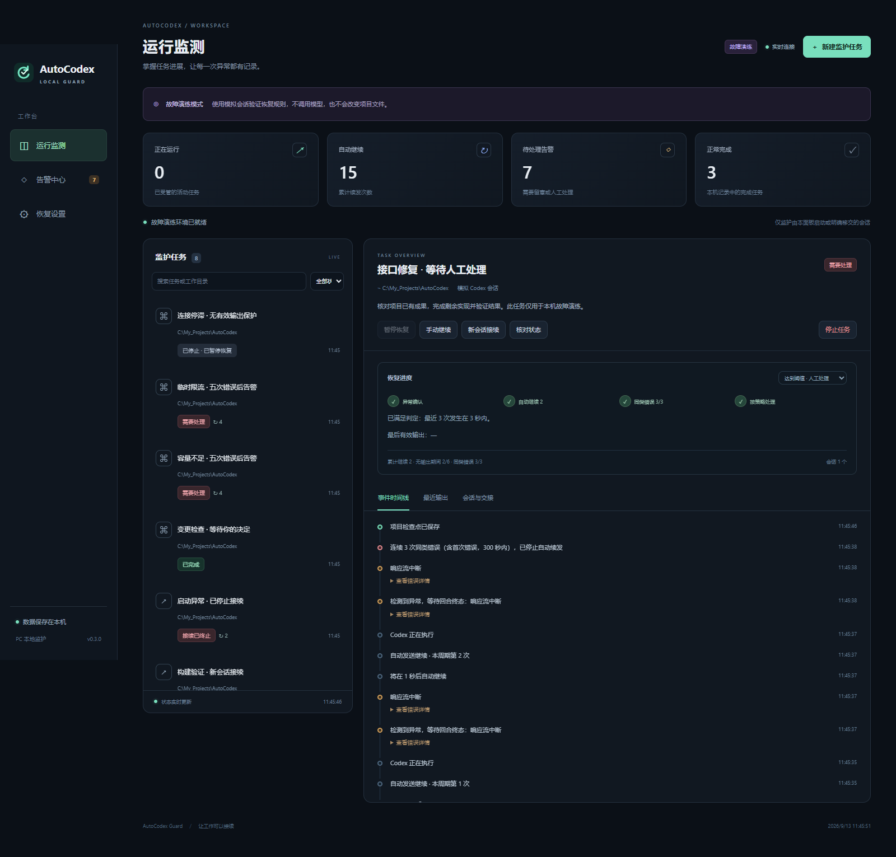

# AutoCodex Guard

本机运行的 Codex 异常恢复守护服务、中文监测面板和 Codex 插件。

源码仓库：[3294798852/AutoCodex](https://github.com/3294798852/AutoCodex)（当前为私有仓库，需要访问权限）。

**当前版本 0.5.0。首次使用请阅读 [完整中文使用说明](docs/09-user-guide.md)。** 新增已有会话监测：**点击“已有会话” → 选择目标 → “加入监测”**，无需重新开会话或填写 ID。Codex 支持自动发现、启动参数指定、面板保存路径；发布包不依赖开发机安装位置。

新增“恢复设置 → 免打扰”：工作区外文件、常用命令、回收站删除、系统工具、明确确认五个独立开关，以及全部开/关和实时批准记录。默认全关，保存后对新请求立即生效，重启保留。具体支持范围见 [免打扰使用说明](docs/09-user-guide.md#61-免打扰权限自动批准)。

首次异常后自动发送“继续”。普通错误按连续三次同类判定，包含首次错误及两次重试；容量不足和临时限流放宽为五次、四次重试。最近三/五次需在默认 5 分钟内发生，或期间没有有效输出，才按重复故障处理。可以选择人工处理或新会话接续；新会话首轮立即失败会完全停止。

默认连续 10 分钟无有效输出时，必须告警并停止后续自动恢复。时间窗口和无输出时限可在面板配置；有效输出重置无输出计时及对应重试预算，累计次数保留。重试提示、心跳和内部思考不能重置时钟；暂停或等待用户决定期间不计时。

**已有会话可直接监测**：持续跟踪原客户端写入的活动、输出、完成和异常；重启恢复监测，停止观察不影响原任务。需要自动续发和免打扰时，在详情点击“移交并继续”，确认原客户端已停止后由本服务管理。仅观察时显示证据状态，不把没有新日志当作已停止。手机 APP 是下一阶段；本版仅监听本机。



## 快速开始

需要 Node.js 24 或以上；真实运行还需要已安装并配置好的 Codex CLI。本项目已核对 Node 24.18.0 和 Codex CLI 0.153.4。核心服务不需要 `npm install`。

在项目目录的 PowerShell 中运行：

```powershell
# 演练：不调用模型，不修改任务项目文件
.\Start-AutoCodex.ps1 -Demo

# 只检查本机 Codex 的位置、版本与连接，不请求模型生成
.\Start-AutoCodex.ps1 -CheckCodex

# 真实任务：沿用本机 Codex 的上游配置和登录
.\Start-AutoCodex.ps1
```

启动器会隐藏后台窗口并在默认浏览器打开本机面板。演练与真实模式默认都使用 3210 端口；同时运行时为其中一个指定 `-Port 3211`。每种模式有自己的数据目录，同一数据目录只允许一个实例。

Codex 不在常见位置时，在真实面板“恢复设置 → Codex 安装”输入 CLI 文件或安装目录，检测、保存后重启；也可以在启动时明确指定：

```powershell
.\Start-AutoCodex.ps1 -CodexPath 'D:\应用\Codex CLI'
```

上面是示例位置，可替换为任意实际安装路径。优先级为启动参数、`AUTOCODEX_CODEX_COMMAND`、面板保存的路径、自动发现。自动发现检查 PATH、额外搜索目录、npm、用户安装及桌面版可能附带的 CLI；不会把桌面主程序当成可用 CLI。高级路径和扩展方法见使用说明第 3 节。

Windows 发布包解压后在 `autocodex-guard` 根目录运行以上脚本；无需安装 npm 依赖。可以使用 `-DataDir` 选择独立数据目录，升级时继续使用该目录，停止时也传相同参数。

如果希望看到服务输出，使用 `-Foreground`；也可以直接运行：

```powershell
npm run demo
# 或 npm start
```

直接运行后，打开终端提示的 `open-panel.html` 文件即可连接，无须手动复制口令。前台运行可按 Ctrl+C 关闭；后台运行可使用：

```powershell
.\Stop-AutoCodex.ps1 -Demo
.\Stop-AutoCodex.ps1
```

## 使用流程

已有会话使用“已有会话 → 加入监测”；需要自动恢复时，点击“移交并继续”。下面是创建新任务的流程。

已有会话优先使用“已有会话 → 加入监测”；需要自动恢复时，再点击“移交并继续”。下面是创建新任务的流程。

1. 在“新建监护任务”填写目标和本机工作目录。模型留空会使用现有 Codex 配置，并保存实际选用的模型和上游标识供接续时使用。
2. 选择反复错误后“人工处理”或“自动新会话接续”。默认人工处理。
3. 在时间线查看运行、内部重试、插件继续、会话接续和告警。
4. 在“恢复设置 → 免打扰”按需开启自动批准；未开启或未识别的操作及普通问题，在任务详情人工处理。
5. 可暂停自动恢复、停止任务、核对派发结果、手动继续或创建接续会话。

“暂停恢复”保留当前正在运行的工作，同时暂停后续自动派发和自动批准。“停止任务”取消自动计划并请求 Codex 中断当前回合。确认告警不会恢复任务。

## 插件

源码插件目录为 `plugins/autocodex-guard`。包含经过校验的兼容插件 manifest、技能及 stdio MCP 服务，提供：

| 工具 | 用途 |
|---|---|
| `guard_status` | 读取指定受管任务、恢复次数和未确认告警 |
| `guard_checkpoint` | 保存已完成、待办和约束等工作检查点 |
| `guard_read_handoff` | 读取旧对话链接、原目标、检查点和近期历史 |

启动器会调用 `Configure-LocalPlugin.ps1` 生成当前电脑的绝对路径配置；移动项目或解压到新目录后，重新运行启动器即可。它只写此插件的 `.mcp.json`，不修改用户全局 Codex 设置，不自动安装市场。

先启动服务生成本机配置，再通过你的 Codex 插件安装流程接入此目录。初始 `.mcp.json` 为未配置模板，不含开发机路径；移动目录后需要重新生成，并更新客户端已保存的 MCP 注册或插件缓存。[使用说明第 10 节](docs/09-user-guide.md#10-可选接入-codex-插件工具) 提供读取实际配置、注册独立 MCP 的完整命令。注册是可选操作，会修改用户的 Codex MCP 配置。

插件查询/检查点使用独立口令，不能用它调用继续、停止、创建、路径配置或批准接口。

## 校验与打包

以下开发校验命令在源码项目目录执行。解压发布包后使用启动/停止脚本；如本机限制执行 PowerShell 脚本，可进入包内 `runtime` 目录直接运行 `npm run demo` 或 `npm start`，按 Ctrl+C 关闭。

```powershell
npm test               # 规则、持久化、并发、协议、API、MCP 与 SSE
npm run check          # 源文件语法与 JSON
npm run smoke:codex    # 真实 Codex 握手，不请求模型生成
npm run diagnose:codex # 路径、版本与连接诊断
npm run smoke:faults   # 真实 Codex + 本机故障上游，无付费模型请求
npm run smoke:dnd      # 真实 Codex 命令批准与 Windows 回收站工具，本机测试上游
npm run smoke:existing # 两个真实 Codex 进程验证原会话观察，本机测试上游
npm run smoke:recycle  # 临时文件/目录入回收站，再恢复并核对内容
npm run package        # 生成 dist/autocodex-guard 及 Windows ZIP
```

发布包携带插件、完整本机服务、启动/停止脚本及文档。服务放在包内 `runtime/`；启动器会自动识别这个目录。ZIP 不包含连接口令、数据库、任务历史、日志或开发缓存。`SHA256SUMS.json` 可用于核对文件。

自动测试覆盖恢复规则、安装发现、免打扰分类、持久化、断线与重复请求；真实 CLI、Windows 回收站、界面和发布包的实际结果见 [验证报告](docs/06-validation.md)。历次证据保留在报告中。

详细设计与实际验证结果：

- [需求及验收指标](docs/01-requirements.md)
- [实现架构](docs/02-architecture.md)
- [分阶段计划](docs/03-implementation-plan.md)
- [Codex 框架核实记录](docs/04-protocol-evidence.md)
- [操作与恢复指南](docs/05-operations.md)
- [验证报告](docs/06-validation.md)
- [接口与维护说明](docs/07-development.md)
- [三次/五次判定与长期无输出设计](docs/08-recovery-policy-v2.md)
- [使用说明](docs/09-user-guide.md)
- [安装发现与发布设计](docs/10-installation-design.md)
- [Git 仓库使用与维护](docs/11-git-publishing.md)
- [免打扰需求指标](docs/12-dnd-requirements.md)
- [免打扰实现方案](docs/13-dnd-implementation.md)
- [项目接续记录](PROJECT_STATE.md)

## 已知边界

- app-server 是 Codex 的实验性集成接口，未来版本需要重新验证。
- 不扫描并控制桌面应用全部活动任务；历史会话必须先停用另一客户端再移交。
- 发送结果未知时先核对，无法唯一确认就停下来等待人工处理，避免重复执行。
- 静默不等于断流；仅长时间没输出会告警，不强制中断工具。
- 免打扰处理受管 Codex 的请求；全关不撤销沙箱本来已允许的操作。未知命令保留人工，Windows UAC、登录和其他软件弹窗不受接管。回收站工具在本版新建的 Windows 会话中提供，移交老会话可能没有此工具。
- 浏览器桌面通知需要用户授权，并保持面板打开；服务停机期间没有监护。当前没有系统托盘、自启动安装器或手机推送。
- 真实 Codex 的本机故障注入已验证；真实付费上游的长时间稳定性、不同账号策略及后续版本仍需实际项目验收。

- [已有会话监测需求与实现](docs/14-existing-sessions.md)
