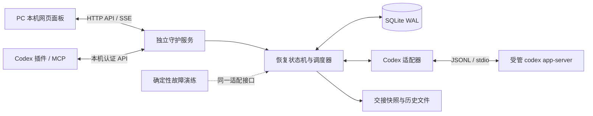

# 实现架构与关键决策

版本：0.2；修订日期：2026-09-13。

## 1. 架构

### ADR-001：使用独立守护服务

插件随宿主回合执行，不能保证其在宿主故障后存活。恢复定时器、计数器、事件持久化和面板属于独立 Node 进程。插件只提供模型内查询和检查点接口。Stop hook 无法覆盖进程崩溃、连接断开等全部失败，也无法替代全局守护。

### ADR-002：官方 app-server 作为控制边界

使用官方 `initialize`、`thread/start/read/resume`、`turn/start/interrupt` 及运行事件。默认 stdio，无额外网络暴露。适配器处理协议细节，状态机不直接访问 UI 或 Codex 私有 SQLite。CLI 版本固定作为兼容性基线，启动/诊断可检查可用性。

公开 app-server 仍标记实验性，兼容性以验证版本为准。0.5.0 使用 thread/list、thread/read 的元数据发现已有会话，再以有界 JSONL 增量读取获得活动证据；独立服务 notLoaded/历史 interrupted 不作为桌面终态。观察模式与控制模式明确分离，详细见 [已有会话设计](14-existing-sessions.md)。未来直接控制桌面活动会话仍需验证共享端点及所有权。

### ADR-003：零运行依赖

Node.js 24 LTS、ES modules、内置 SQLite/HTTP/进程接口、原生浏览器模块。这样无需下载 npm 包就能运行和验证核心功能，减少断网环境的部署障碍。测试用 `node:test`；图形验证工具作为开发环境外部能力，不成为运行依赖。

### ADR-004：错误判定与决策分离

分类器先看结构化错误与 HTTP 状态，再做保守文字匹配；认证/预算/政策优先。状态机只消费归一化事件。`willRetry`、文字增量、普通命令执行失败均不能单独触发自动续发。最终失败以回合终态确认。

错误计数包含首次失败：普通 3 次、容量/临时限流 5 次；保存最近 N 次的时间和输出序号，在“5 分钟窗口内或没有有效输出”时按策略处理。单独的输出监测器记录有效正文/成功工具结果与 10 分钟期限；重试提示、内部思考和普通活动心跳不更新它。

### ADR-005：动作意图先落盘

每个派发动作有 UUID、任务代数、来源失败回合和唯一键；先事务持久化，后调用 Codex。续发消息携带动作标识供重启时核对。明确 RPC 拒绝可结算；网络中断/超时导致结果未知则标记 uncertain，并读取历史核对。无法确认时转人工，不声称分布式 exactly-once，也不重复发送。

自动恢复只处理已确认归属于当前受管任务的终态。通知早于 RPC 返回时必须排队和去重；旧会话、旧回合、已终止任务的迟到事件不能重新激活自动流程。

### ADR-006：持久化与互斥

SQLite 事务保存任务 JSON、事件、动作、告警、检查点与交接包；WAL + FULL 同步。一个数据目录只有一个服务实例（独占锁）。核心决策按任务串行；不同任务独立计数。重启后先恢复已排定的重试；上次正在运行或发送结果未知的任务先向 Codex 核对。

0.2 保存 incident.version、错误时间/输出序号、无输出预算及 outputMonitor。自动新会话保留无输出计时，人工接续才重建基线；暂停和用户等待保存起止状态。旧数据缺少证据时记录升级事件并开启新基线，旧的待换会话计划转人工；保留旧历史及累计次数。

### ADR-007：交接为有界材料

全新会话仍使用原目录与受管配置。交接材料包含原目标、旧会话 ID/链接、近期用户/助手可见消息、最近工具结果摘要、检查点与失败历史。不复制原始推理或认证数据；文本有上限。先存 DB 和 JSON/Markdown 文件，再发接续消息。无法导出历史时要明确说明，不编造工作进展。

首次创建或移交时保存 app-server 返回的实际 model 与 modelProvider；后续 resume 和 replacement 显式传回这两个值，避免默认配置变化导致模型或上游标识漂移。这里只固定标识，不复制上游密钥和配置文件；同名 provider 的端点/凭据配置仍由用户的 Codex 配置管理。

### ADR-008：本地 API 边界

仅 127.0.0.1；随机访问令牌保存在服务数据目录，浏览器通过 URL fragment 交换会话 cookie，随后清掉 fragment。修改操作校验同源/授权；SSE 使用同源 cookie。插件通过本地连接文件读取令牌，绝不写入 manifest 或模型消息。面板以 textContent 渲染日志，CSP 禁止外部脚本。

SSE 写入返回 false 时表示背压，等待 drain 后续发最新快照；10 秒无法排空才断开慢客户端，避免较大的正常快照被误断开。推送不携带内部正文缓冲和去重摘要。

## 2. 状态与数据

任务主要状态：`starting / running / retry_wait / recovering / waiting_user / needs_attention / completed / stopped / failed`。`paused` 为独立开关：暂停自动恢复时当前 Codex 工作可以继续，终态仍被记录。

任务保存：id、目标、目录、model/modelProvider、会话链、回合、策略、累计/无输出重试次数、同类错误时间/输出序号、输出计时/暂停/保护状态、接续窗口、动作意图、最近活动和摘要。

事件保存：递增 ID、taskId、时间、事件种类、级别、可读说明和有限元数据。界面从权威快照渲染，事件流用于实时更新和断线刷新。

告警保存：id、taskId、原因、等级、发生时间、确认时间。确认告警不等于恢复任务。

## 3. 故障处理顺序

1. 校验事件所属线程/回合与当前状态。
2. 原子去重、记录错误与更新计数。
3. 致命或需用户错误 → 告警；否则计算退避或接续决策。
4. 计划持久化；定时到期再次检查暂停、停止、批准和动作所有权。
5. 发送前持久化 intent；收到 turn/start 结果后保存 turnId。
6. 新会话首轮立即失败 → 最终停止；正常完成 → 周期重置。

## 4. 手机扩展边界

第一版 HTTP `/api/v1` 与 SSE 可复用。第二期需另外设计 PC/手机配对、TLS、访问撤销、远程只读权限及系统推送；当前不监听局域网，也不把本机 token 当作公网认证方案。

## 5. 0.4 免打扰批准扩展

`dnd-policy.mjs` 独立处理五类开关、目录校验、命令结构和确认表单；`Supervisor` 在任务串行队列中核实会话/回合/连接、去重、持久化决定，再经适配器回应。与恢复分类器分开，工具请求本身不触发续发计数。全局设置存于 SQLite meta，使用 revision 检查并发修改；原始请求仅保存在内存，批准审计保存脱敏预览。

批准状态为 pending → sending → answered；已解决/过期分别为 resolved/expired，写入异常和执行结果不明为 uncertain。`approvalBlocked` 锁定继续与自动换会话，跨迟到终态、重启保持；只有用户核对后的手动接续清除。已显示的 pending 请求不因开关变化而自动处理。

Windows 新建会话注册动态工具 autocodex_recycle，`recycle.mjs` 校验目标后通过 stdin JSON 调用 `src/native/recycle.ps1`。原生 IFileOperation 仅允许回收语义并报告完成清单，不降级为永久删除。停止、断线或请求解决可取消本服务启动的原生进程。前后端复用原有 HTTP/SSE；后续适配其他平台只需替换回收后端和平台能力描述。详见 [免打扰方案](13-dnd-implementation.md)。
