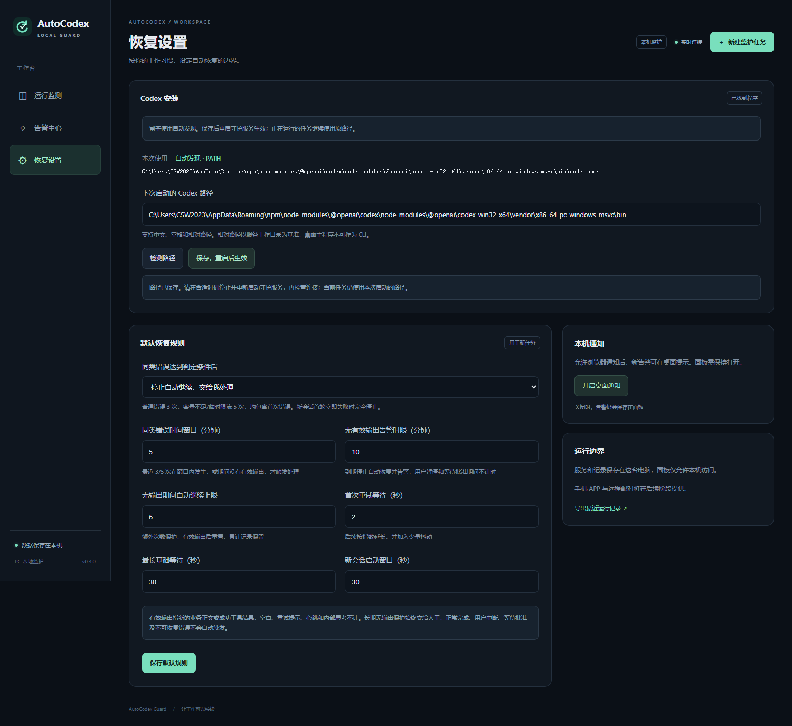
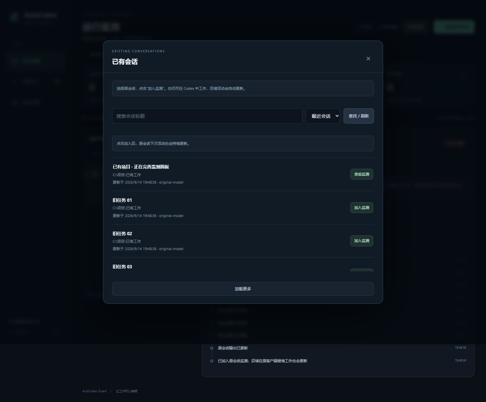
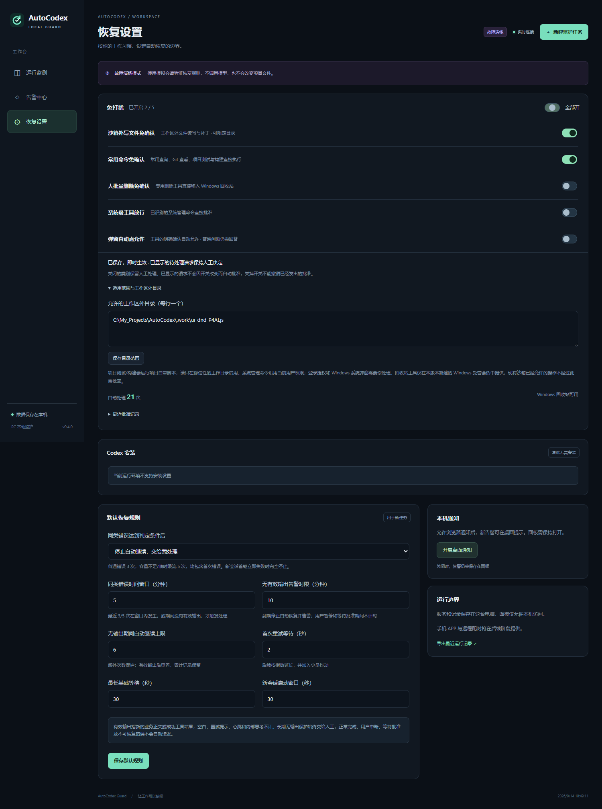

# AutoCodex Guard 使用说明

适用版本：**0.5.0**；更新：2026-09-14；当前发布与实机验证平台：Windows PC。

AutoCodex 在本机监护 Codex 任务：遇到可恢复错误时自动发送“继续”，反复出错时告警，并可按设置新建会话接续。浏览器面板显示任务、恢复次数、输出、告警和交接记录。

**已有 Codex 会话：启动面板 → 点击“已有会话” → 找到目标，点击“加入监测”。无需复制会话 ID，无需重新输入工作目录或任务。**

新安装可先演练。已经完成安装的用户直接启动真实面板即可。

## 1. 使用前准备

| 项目 | 要求 |
|---|---|
| 电脑 | 当前发布包在 Windows 验证；可使用 Windows PowerShell 5.1 或更新的 PowerShell |
| Node.js | 24 或更新版本，安装后重新打开终端，确保 `node --version` 可运行 |
| Codex | 真实任务需要可运行 `app-server` 的 Codex CLI；本版验证版本为 0.153.4 |
| 登录与上游 | 先确认该 CLI 已登录，且已有的模型/上游配置能正常工作 |
| 浏览器 | 当前 Chrome 或 Edge；面板仅供这台电脑访问 |
| 解压目录 | 当前用户有写入权限的目录；完整解压，不在 ZIP 内直接启动 |

核心服务没有额外 npm 依赖，**解压后不需要运行 `npm install`**。演练模式只需要 Node.js，不需要 Codex、账号或模型费用。

如尚未安装 CLI，可参考 [Codex 官方安装说明](https://developers.openai.com/codex/cli)，例如通过 npm 安装：

```powershell
npm install -g @openai/codex
codex --version
codex
```

最后一条用于进入 Codex 并按其提示登录。已有可用安装时不用重复安装。只安装桌面应用时，AutoCodex 会尝试寻找其中附带的 CLI；能否找到取决于桌面分发方式。检测失败时可手动指定 CLI 或另行安装 CLI。

AutoCodex 沿用所启动 CLI 的登录和配置，不要求在面板输入 API 密钥。`CODEX_HOME` 如已设置，也会沿用。桌面版、CLI 或不同用户目录的登录/上游配置可能不同，请以连接和实际任务结果为准。

## 2. 解压与启动

将 `autocodex-guard-0.5.0.zip` 解压，进入其中的 `autocodex-guard` 文件夹，在该文件夹打开 PowerShell。此处应能看到 `Start-AutoCodex.ps1`、`Stop-AutoCodex.ps1` 和 `runtime` 文件夹。

先启动演练：

```powershell
.\Start-AutoCodex.ps1 -Demo
```

启动器会在后台运行服务，并打开默认浏览器。若系统阻止执行此脚本，可在同一目录用一次性的启动方式运行：

```powershell
powershell -NoProfile -ExecutionPolicy Bypass -File .\Start-AutoCodex.ps1 -Demo
```

这只影响本次 PowerShell 进程，不永久更改系统执行策略。组织设备仍应遵守其管理员策略。

在面板点击“新建监护任务”，选择演练场景，然后“开始监护”。可观察偶发断流、重复错误、容量不足、限流和新会话失败等流程。演练不会调用模型，也不会修改任务项目。

完成演练后关闭它，再检查真实 Codex：

```powershell
.\Stop-AutoCodex.ps1 -Demo
.\Start-AutoCodex.ps1 -CheckCodex
.\Start-AutoCodex.ps1
```

`-CheckCodex` 只检查程序版本与 app-server 连接，不创建任务、不请求模型生成；成功结果包含 `ok: true`、实际路径、版本和 `connected: true`。最后一条才启动真实监护面板；创建真实任务后会使用你的 Codex 账号或上游额度。

演练和真实模式默认均使用端口 **3210**。同时运行时为其中一个指定 `-Port 3211`，并保持各自的数据目录不同。

## 3. Codex 路径如何识别

**没有固定到某台电脑的 Codex 路径。** 程序按以下优先级选择：

| 优先级 | 来源 | 用途 |
|---|---|---|
| 1 | 启动器 `-CodexPath` / 主程序 `--codex-command` | 本次启动明确选择一个安装 |
| 2 | 环境变量 `AUTOCODEX_CODEX_COMMAND` | 启动环境统一指定 |
| 3 | 面板中保存的路径 | 此数据目录的后续启动继续使用 |
| 4 | 自动发现 | 未指定路径时自动定位 |

自动发现先检查系统 `PATH`，再检查 `AUTOCODEX_CODEX_SEARCH_PATHS` 中的额外目录、npm 常见目录、用户安装目录、桌面版可能附带的 CLI。Windows 会根据当前用户的 `APPDATA`、`LOCALAPPDATA` 等环境信息计算位置，不写入某个用户名或固定磁盘。桌面版托管 CLI 的版本目录按目录更新时间选择，最多检查 24 个候选。

这些是已实现的候选布局，不是对所有安装器的承诺。自定义安装目录、未来的新布局、没有放入 PATH 的特殊安装，可用手动路径或额外搜索目录扩展。不会遍历整块磁盘，也不会自行安装/更新 Codex。

如果电脑有多份 Codex，以面板“恢复设置 → Codex 安装 → 本次使用”显示的路径为准。手动指定失效时会报告错误，**不会悄悄换用另一份安装**。

### 3.1 在面板输入并保存



1. 以真实模式启动。即使没找到 Codex，面板仍可打开。
2. 点击运行页“安装路径”，或左侧“恢复设置”。
3. 在“Codex 安装”中输入 CLI 程序文件或安装目录；留空表示自动发现。
4. 点击“检测路径”。该按钮检查文件布局，不启动模型任务。
5. 点击“保存，重启后生效”。在合适时机停止并重新启动守护服务。
6. 回到运行页点击“检查连接”。连接成功后再创建任务。

“本次使用”始终表示当前服务的选择。保存后出现重启提示时，当前任务仍使用旧路径。配置与数据库一起保存；更换数据目录等于使用另一套配置。

如果界面提示启动参数或环境变量覆盖，先移除该覆盖并重启，才能使用面板保存的路径。可暂时通过 `-CodexPath ''` 强制自动发现，但这仍是一次启动参数覆盖。

面板接受绝对路径和相对路径。相对路径以**服务的工作目录**为基准：默认后台发布包是 `runtime` 目录，源码启动是项目根目录。日常使用建议填绝对路径。中文、空格均可直接输入，不需要额外引号。

### 3.2 启动时手动指定

以下 `D:\应用\Codex CLI` 是示例，请换成实际位置：

```powershell
# 指定 CLI 文件
.\Start-AutoCodex.ps1 -CodexPath 'D:\应用\Codex CLI\codex.exe'

# 也可以指定安装目录
.\Start-AutoCodex.ps1 -CodexPath 'D:\应用\Codex CLI'

# 先诊断指定位置
.\Start-AutoCodex.ps1 -CheckCodex -CodexPath 'D:\应用\Codex CLI'
```

可输入原生 `codex.exe`、npm 的 `codex.js`，或者标准 npm `codex.cmd` / `codex.ps1`。npm 包内若有匹配平台的原生程序，会优先直接启动它；包装脚本不会通过 shell 执行。任意自定义 `.cmd` / `.bat` / `.ps1` 不是受支持的入口。

桌面应用的主 `Codex.exe` 不一定是 CLI。应选择附带的 CLI，或输入桌面安装目录让程序检查已支持的子目录。对于识别不出的桌面布局，请安装独立 CLI。

参数只影响这次启动，不会自动保存到面板；要长期保存，请使用面板。启动器的相对路径以你运行启动脚本时所在的目录为基准。

### 3.3 环境变量与扩展目录

```powershell
# 当前终端中指定 Codex，后续从此终端启动时有效
$env:AUTOCODEX_CODEX_COMMAND = 'D:\应用\Codex CLI'
.\Start-AutoCodex.ps1

# 取消当前终端的覆盖
Remove-Item Env:\AUTOCODEX_CODEX_COMMAND -ErrorAction SilentlyContinue

# 加入额外搜索位置；Windows 用分号分隔
$env:AUTOCODEX_CODEX_SEARCH_PATHS = 'D:\工具\Codex;E:\便携应用\Codex'
.\Start-AutoCodex.ps1 -CheckCodex
```

额外搜索目录适用于自动发现模式，排在 PATH 之后。需要强制选择某份安装时用明确路径。

## 4. 创建真实监护任务

在“运行监测”点击“新建监护任务”，填写：

| 字段 | 填写说明 |
|---|---|
| 任务来源 | 新工作选择“创建一个新 Codex 会话” |
| 任务名称 | 便于辨识的名称，例如“完成登录模块” |
| 工作目录 | Codex 要处理的本机项目绝对路径，且目录已存在 |
| 任务描述 | 目标、验收要求和必须遵守的约束 |
| 错误反复后 | 默认告警后人工处理；也可选自动新会话接续 |
| 项目访问 | 允许修改当前项目，或只读检查 |
| 模型 | 可留空，使用该 CLI 的现有配置 |

点击“开始监护”后，在任务详情查看“事件时间线”“最近输出”“会话与交接”。实际选用的模型和上游标识会保留，用于后续接续。匹配已开启免打扰规则的批准自动处理；其他请求进入“等待用户”，由你决定。

当前版本支持从列表选择已有会话监测。自动续发、自动新会话接续和免打扰用于**从 AutoCodex 创建，或明确移交给它的任务**。

## 5. 监测已有会话

1. 点击网页右上角 **“已有会话”**。
2. 找到你在 Codex 中使用的会话，点击 **“加入监测”**。可搜索标题、“加载更多”，或切换到“已归档”。
3. 回到任务详情查看状态、最近输出、事件和告警；你可以继续在原 Codex 中工作。



已有会话是否正在运行都可以加入。会话完成后仍保留监测，下次在原客户端继续工作时自动更新；关闭网页不影响后台监测。服务重启后也会继续读取。点击“停止监测”只停止观察，不会停止 Codex；点击“恢复监测”可重新开启。

面板每秒读取一次已经写入本机的记录，典型更新约 1 秒。模型流式文字尚未写入记录时可能暂时看不到。“最近有活动”说明最近 30 秒收到了活动证据；“状态待确认”说明近期没有新证据，可能仍在思考、执行工具或等待，不能据此断言已经崩溃。默认持续 10 分钟没有活动证据且没有明确终态时提醒核对。明确错误、完成和中断分别显示；命令失败单独记录，继续观察后续处理。

初次加入显示近期记录；已经发生过的历史错误会显示在状态中，但不会补发一批旧通知。原始日志不受修改。当前最多同时监护 20 个任务，观察中的已完成会话仍占名额，可停止其监测释放名额。

### 5.1 希望原会话也自动继续或自动批准

在已经加入监测的任务详情点击 **“移交并继续”**。先在原 Codex 中停止该会话，再勾选确认并提交；继续消息可以留空。程序自动使用原会话 ID、目录、模型和历史，发送继续并接入本服务的恢复规则。移交之后由面板管理，避免同时从原客户端操作。

仅监测时，权限决定仍在原客户端处理，AutoCodex 不会自动发送继续或批准。因为本机独立服务无法直接持有桌面端已有请求，仅仅读取记录不能代替控制连接。新旧会话的免打扰范围一致，但旧会话无法新增专用回收站工具。

高级手动入口仍保留：“新建监护任务 → 接管已停止的历史会话”，供明确知道 ID 的用户使用。日常使用列表即可。

### 5.2 列表找不到会话

清空搜索文字，点击“查找 / 刷新”，或切换“已归档”。列表使用所选 Codex CLI 可读的本机历史，包含桌面、CLI、IDE 与 app-server 主会话；不显示仅存在于云端、其他电脑或不同用户下的历史。

如果你主动使用了自定义 Codex 数据目录，应从设置了相同 CODEX_HOME 的终端启动 AutoCodex。选择另一份 CLI 程序并不等于选择另一套会话数据。安装路径仍可在“恢复设置 → Codex 安装”自动发现或手动设置。

## 6. 自动恢复规则

| 情况 | 默认行为 |
|---|---|
| 偶发断流、超时等可恢复错误 | 保存记录，等待后发送“继续” |
| 普通同类错误 | 首次错误加两次继续均失败，即连续 3 次，按所选策略处理 |
| 容量不足 / 临时限流 | 首次错误加四次继续均失败，即连续 5 次，按所选策略处理 |
| 重复判定的额外条件 | 最近 3 / 5 次在默认 5 分钟内，或期间没有有效输出 |
| 连续无有效输出 | 默认 10 分钟告警并锁定后续自动恢复 |
| 无输出期间继续次数 | 默认最多 6 次，作为额外次数保护；有效输出后重置 |
| 新会话接续 | 默认最多自动创建 1 个接续会话，保存旧链接、目标、检查点与近期历史 |
| 接续会话首轮立即失败 | 默认 30 秒启动窗口内失败且无成功工具进展时，完全停止自动接续并告警 |
| 正常完成 / 用户中断 | 不自动续发 |
| 需要批准 / 用户回答 | 按免打扰设置处理可识别批准，其他请求等待用户；等待期间不自动续发 |
| 明确的认证失败 / 额度耗尽 / 不可恢复错误 | 转人工处理 |

有效输出包括新的业务正文或成功工具结果。空白、心跳、内部思考及识别出的纯重试提示不计。暂停恢复、等待批准或回答期间不计无输出时间；自动重试、换会话和重启不会清空该时钟。

无输出告警后，正在执行的回合可能仍在运行；面板停止的是后续自动恢复。迟到输出或“确认告警”都不会解锁，核对后需手动处理。

“恢复设置”中的默认规则用于**之后新建的任务**。当前任务的“达到阈值”策略可在任务详情直接切换。更低的次数上限可能先于 3 / 5 次阈值生效。

如果上游正文被 Codex 隐去，仅看到 HTTP 429，服务无法确定是额度耗尽还是临时限流，会按可见限流有限重试。更多证据边界见 [验证报告](06-validation.md)。

### 6.1 免打扰权限自动批准

打开左侧 **恢复设置 → 免打扰**。第一次使用和从 0.3 升级时五项默认关闭。点击单项开关，看到“已保存，即时生效”后设置已经生效，无须重启；总开关可全部开启或关闭。“已开启 N / 5”显示当前数量。



这些设置适用于此服务数据目录下的所有受管任务；演练与真实服务的设置分别保存。与下面“默认恢复规则”只影响新任务不同，免打扰会影响现有任务的**后续新请求**。已经显示的待处理请求仍由你决定；关闭开关不能撤销已发出的批准。

| 开关 | 本版处理范围 | 使用提示 |
|---|---|---|
| 沙箱外写文件免确认 | 明确路径的文件读写权限、增加/更新补丁，以及简单的 Set-Content、Add-Content、New-Item | 展开“适用范围与工作区外目录”，可每行填写一个允许目录；留空表示不额外限定工作区外目录 |
| 常用命令免确认 | 常见文件查询、Git 查看、项目测试和构建 | 示例：`git status --short`、`git diff`、`npm test`、`npm run build`；项目脚本会按项目定义执行，适合自己信任的工作目录 |
| 大批量删除免确认 | 专用 `autocodex_recycle` 工具，每次 1–80 个明确文件或文件夹 | 实际移入 Windows 回收站；不能回收工作根、运行数据、系统目录、版本/凭据目录、联接点等受保护目标 |
| 系统级工具放行 | 支持的服务、进程、网络和注册表管理命令 | 示例：Get-Service、Restart-Service、Get-Process、Stop-Process、ipconfig、tasklist、明确的 sc.exe、reg query/add；继续使用当前账户权限 |
| 弹窗自动点允许 | 受管 Codex 工具发来的明确允许/拒绝确认或单项布尔确认 | 普通选择题、自由输入、密码和登录授权仍需你处理；Windows UAC 和其他软件弹窗不属于此项 |

常见读取命令还包括 Get-Content、Get-ChildItem、Get-Item、Test-Path、Resolve-Path、cat、ls、dir、type、rg 的已识别参数；Git 仅支持 status/diff/log/show/查看 branch。npm/pnpm/yarn 支持 test/build/lint/check 和 run test/build/lint/check/typecheck；node/python 只支持版本查询。脚本展开、重定向、复杂命令、未识别参数会保留人工，并在请求上说明原因。

一次操作可能需要多个开关。例如，常用查询访问工作区外路径时，需要同时开启“常用命令”和“沙箱外写文件”；系统命令在工作区外目录执行时，还需满足文件目录范围。复合命令必须每个片段都匹配。只读任务保留人工批准；回收站工具不在只读任务执行。

**回收站使用：**在 0.4.0 新建 Windows 受管任务，任务详情显示“回收站工具已接入”。告诉 Codex 要删除的具体文件或目录即可，服务已提示它通过专用工具处理。开启删除开关后，目标检查通过即入回收站；关闭时显示目标供人工批准。移交旧会话可能缺少该工具，可使用面板“新会话接续”接入。模型若调用 `rm`、`Remove-Item` 等普通删除命令，仍须人工处理，并不会自动改成回收站删除。

恢复文件时，在 Windows 回收站核对原位置后选择“还原”。网络/设备路径不支持；无法回收、超时或部分完成时会告警并停止自动恢复，不改用永久删除，也不自动重试。请先核对原目录和回收站，再处理剩余项。

**查看记录：**运行页顶部显示启用数和自动处理总次数，任务详情显示该任务的次数；时间线与“最近批准记录”显示处理来源、原因和时间。批准表示本次决定已发送，实际命令是否成功仍以工具结果为准。日志导出含脱敏批准记录；预览有脱敏或省略时会提示先核对原始操作。

若提示“批准或回收结果待核对”，自动续发和新会话接续会保持停止。即使随后收到输出或失败也不会自行解锁；确认执行结果、处理剩余请求，待原回合停止后再使用“手动继续”或“新会话接续”。服务重启保留这项保护。

可先演练：启动 `-Demo`，开启“常用命令免确认”，新建场景“免打扰自动批准”，观察自动完成与记录；关闭开关后再新建一次，会等待人工批准。演练不执行真实命令。

免打扰只处理 Codex 向本服务发起的批准。沙箱本来允许的操作不会经过它，因此全关不等于阻止所有命令；它也不会修改全局 Codex 权限设置或 Windows 管理员权限。

## 7. 告警与人工操作

| 操作 | 含义 |
|---|---|
| 暂停恢复 | 暂停后续自动派发与自动批准；当前回合继续运行 |
| 恢复监护 | 解除主动暂停，继续原监护计划；不解除长期无输出保护 |
| 停止任务 | 取消自动计划，并请求 Codex 中断当前回合 |
| 核对状态 | 读取历史，确认之前的派发是否成功，避免重复工作 |
| 手动继续 | 在允许操作的停止/待处理状态，向原会话接续 |
| 新会话接续 | 保存交接材料，人工选择新会话继续 |
| 确认告警 | 仅标记已知晓，不恢复任务 |
| 保存检查点 | 保存已完成、待办和约束，方便新会话衔接 |

按钮不可用通常表示任务仍在运行、仍有待核对动作或不符合操作条件。先查看任务状态和时间线中的具体原因。

浏览器通知可在“恢复设置 → 本机通知”开启，需浏览器许可且面板保持打开。关闭浏览器后，后台服务仍继续监护并保存告警，但本版不保证弹出系统通知。

## 8. 关闭、重新打开与重启

关闭浏览器页面不会关闭后台服务。启动时会显示 `open-panel.html` 的位置；双击该文件可重新打开面板，无需复制口令。

```powershell
# 正常关闭真实模式
.\Stop-AutoCodex.ps1

# 正常关闭演练模式
.\Stop-AutoCodex.ps1 -Demo

# 重新启动真实模式
.\Start-AutoCodex.ps1
```

同一数据目录只能运行一个实例，重复运行启动器会报已有进程占用。不要为了重新打开页面而重复启动服务。前台运行时可按 Ctrl+C 关闭。

重启前优先等待任务完成，或主动停止任务。服务会保存状态并关闭它管理的 Codex 连接；重启后会核对不确定的活动和派发，不保证正在执行的工具跨进程重启不中断。若提示旧受管进程仍可能存活，应先核对旧服务，再继续。

## 9. 启动参数与数据位置

| 参数 | 作用 |
|---|---|
| `-Demo` | 演练模式 |
| `-CodexPath '路径'` | 本次指定 CLI 文件、npm 启动文件或安装目录 |
| `-CheckCodex` | 显示选择来源、版本、路径并检查连接，随后退出 |
| `-Port 3211` | 使用其他本机端口 |
| `-DataDir '路径'` | 指定独立数据目录；停止时也传同一目录 |
| `-NoBrowser` | 后台启动，不自动打开页面 |
| `-Foreground` | 前台运行并显示日志；手动打开日志提示的面板入口 |

默认路径：

| 内容 | 发布包 | 源码目录 |
|---|---|---|
| 真实数据 | `runtime/.autocodex/live/` | `.autocodex/live/` |
| 演练数据 | `runtime/.autocodex/demo/` | `.autocodex/demo/` |
| 项目使用说明 | `docs/09-user-guide.md` | 相同 |

数据目录中的 `guard.sqlite` 保存任务、设置、事件、告警和检查点；`handoffs/` 保存交接文件；`service.log` 与 `service-error.log` 是后台服务日志。`connection.json` 和 `open-panel.html` 含本机访问凭据，应留在自己电脑上，不随发布物共享。

推荐长期使用独立数据目录，方便更换程序版本：

```powershell
$guardData = Join-Path $env:LOCALAPPDATA 'AutoCodexGuard\live'
.\Start-AutoCodex.ps1 -DataDir $guardData
# 停止时使用同一个位置
.\Stop-AutoCodex.ps1 -DataDir $guardData
```

也可用 `AUTOCODEX_DATA_DIR`；显式 `-DataDir` 优先。同一自定义数据目录不要交替用于演练与真实模式。

发布包没有开发测试脚本。需要直接启动时，进入 `runtime` 后运行 `npm start` / `npm run demo`；源码中在项目根目录运行。主程序对应参数为 `--codex-command`、`--data-dir`、`--port`、`--demo`、`--diagnose-codex`。直接运行不会自动生成插件连接配置，使用插件时另运行 `Configure-LocalPlugin.ps1`。

## 10. 可选：接入 Codex 插件工具

独立监护与面板不依赖插件安装。插件额外让 Codex 查询受管状态、保存检查点、读取交接材料。

1. 先启动真实服务。启动器会运行 `Configure-LocalPlugin.ps1`，在插件目录生成当前机器的 `.mcp.json`。
2. 如果你的 Codex 客户端支持本地插件安装，按该客户端流程添加插件目录：发布包为 `autocodex-guard` 根目录，源码为 `plugins/autocodex-guard`。
3. 在新会话中使用 `guard_status`、`guard_checkpoint`、`guard_read_handoff`。查询或写入时明确提供受管任务或会话 ID。

初始发布包的 `.mcp.json` 是未配置模板，不包含构建机器的路径。必须先生成本机配置，再添加或重新加载插件。启动器只修改当前插件的配置，不修改用户全局 Codex 配置或插件市场。

若暂不安装整个插件，也可单独注册 MCP。**下面的命令会修改你自己的 Codex MCP 配置，由你按需运行。** 在已启动服务的包根目录执行：

```powershell
$pluginDirectory = (Get-Location).Path
if (-not (Test-Path -LiteralPath (Join-Path $pluginDirectory '.codex-plugin\plugin.json'))) {
    $pluginDirectory = Join-Path $pluginDirectory 'plugins\autocodex-guard'
}
$manifest = Get-Content -Raw -Encoding UTF8 -LiteralPath (Join-Path $pluginDirectory '.mcp.json') | ConvertFrom-Json
$bridge = $manifest.mcpServers.'autocodex-guard'
if (-not $bridge.command) { throw '请先运行 Start-AutoCodex.ps1 或 Configure-LocalPlugin.ps1。' }
$registrationArgs = @('mcp', 'add', 'autocodex-guard', '--env',
    ('AUTOCODEX_CONNECTION_FILE=' + $bridge.env.AUTOCODEX_CONNECTION_FILE), '--', $bridge.command) + @($bridge.args)
codex @registrationArgs
```

CLI 不在 PATH 时，最后一行改为 `& '实际的 CLI 程序路径' @registrationArgs`。这个示例从生成的配置读取位置，不需要粘贴开发者电脑的路径。注册后按客户端要求重新加载 MCP 或打开新会话。

同时运行演练和真实服务时，启动器最后一次生成的 `.mcp.json` 指向最后启动的那一个。要切回真实服务，可手动运行配置脚本并给出真实服务的连接文件：

```powershell
.\Configure-LocalPlugin.ps1 -ConnectionFile '实际真实数据目录\connection.json'
```

插件只有查询和保存检查点权限；控制任务、修改路径、批准操作需面板权限。更多集成细节见 [操作指南](05-operations.md) 与 [开发接口](07-development.md)。

## 11. 升级、移动与备份

1. 正常停止服务，再备份**整个数据目录**。运行中不要只复制 `guard.sqlite` 而遗漏 WAL 文件。
2. 将新版本解压到新目录，保留旧包便于回退；不要把新包覆盖到运行中的服务。
3. 已使用独立 `-DataDir` 时，新版本继续指定它；否则把旧版整个数据目录复制到新版对应位置，或通过 `-DataDir` 指向原目录。
4. 重新启动并检查 Codex 路径、连接和任务状态。面板保存的路径随数据保留；换电脑后可能要重新设置或清空为自动发现。
5. 启动器会根据新目录重新生成插件配置。已注册到 Codex 的 MCP 或已缓存的插件也需要按相同流程更新/重新加载；单独移动文件不会修改客户端已保存的注册信息。

从 0.3 升级到 0.4 时，历史恢复设置和 Codex 路径保留，免打扰初始关闭。已有 0.4 数据目录中的开关会保留；恢复任务前检查是否符合本次工作需要。回收站工具需在 0.4 新建受管会话或使用新会话接续。

`SHA256SUMS.json` 用于核对**首次解压、尚未运行配置脚本**时的发布文件。启动器生成 `.mcp.json` 后，它的内容与原始模板不同是预期行为。数据、日志和访问凭据不包含在 ZIP 中。

## 12. 常见问题

| 现象 | 处理方法 |
|---|---|
| 找不到 Node.js / 版本过低 | 安装 Node.js 24+，重新打开终端再启动 |
| 未找到 Codex | 先用 `-CheckCodex`；检查安装，或在真实面板输入 CLI 文件/安装目录 |
| 找到了程序，但连接失败 | 核对所选的是 CLI，查看版本与错误；诊断只确认协议，账号和上游问题需另处理 |
| 手动路径失效 | 更新或移动 Codex 后重新选择；版本化桌面目录建议用自动发现或安装根目录 |
| 保存后仍用旧路径 | 正常关闭并重新启动服务；检查是否有启动参数或环境变量覆盖 |
| 端口已被占用 | 关闭旧实例，或换用 `-Port`；不同实例使用不同数据目录 |
| 此数据目录已由进程使用 | 用停止脚本关闭对应服务；不要直接删仍在使用的锁文件 |
| 页面要求访问口令 | 从对应数据目录的 `open-panel.html` 重新打开 |
| 启动就显示“不接受跨站请求” | 0.4.0 及更早版本的本地文件跳转被误拦，升级到 0.5.0，停止旧服务后重新启动即可 |
| 桌面会话没有出现在面板 | 当前只监护面板创建或明确移交的任务；按第 5 节移交已停止会话 |
| Codex 等待批准，服务没有自动继续 | 查看“保留人工”原因；核对免打扰开关、支持的命令和目录范围，再处理该请求 |
| 开启开关后旧请求仍在等待 | 旧请求保持人工决定；开关只作用于后续新请求 |
| 提示回收站工具未接入 | 在本版本新建 Windows 受管任务，或对已停止任务选择新会话接续 |
| 告警已确认，任务没恢复 | 确认只表示已知晓；处理原因后手动继续或接续新会话 |
| 电脑休眠或服务退出后没继续监护 | 本机服务必须运行；关闭页面可保留后台监护，关闭服务或休眠不能保证实时响应 |
| 手机不能访问 | 本版仅绑定 `127.0.0.1`，手机配对与 APP 尚未实现 |

遇到其他错误，先看任务时间线与数据目录的 `service-error.log`。分享排错材料前移除访问口令、账号信息和项目敏感内容。

当前集成使用 [Codex app-server](https://developers.openai.com/codex/app-server)。官方仍将其标记为实验接口，新版本 CLI、不同桌面发行方式与长期真实上游运行需继续兼容验证。完整规则与本次验证见 [设计文档](10-installation-design.md) 和 [验证报告](06-validation.md)。
