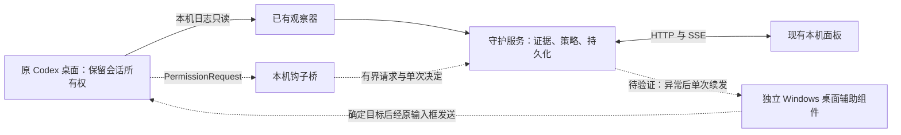

# 原客户端监测模式与写入冲突

本文件保留 0.5.2 的接口调查与 UIA 试验历史。0.6.0 已采用原通信通道辅助层实现原窗口自动续发与免打扰，当前设计和验收见 [17-desktop-relay.md](17-desktop-relay.md)。

日期：2026-09-14；版本：0.5.2。写入冲突处理已修复；公开接口限制已实测；用户已同意先验证桌面辅助组件。桌面读取部分通过，身份绑定和发送尚未通过，不构成原客户端自动续发的交付。

## 最新需求优先级

用户继续在原 Codex 桌面中聊天、发任务、处理必要的人机交互。AutoCodex 在后台观察，仅在已确认的可恢复异常后发送继续，或在命中已开启免打扰规则的权限请求时作答。无需移交所有权、关闭原客户端、复制会话或改用面板聊天。平时不占用输入框、焦点和剪贴板。

自动恢复继续使用已确认的三次/五次错误、时间/有效输出、长期无输出保护和新会话立即失败熔断规则。正常完成、用户主动停止、已有新用户消息、请求已被处理时不得介入。每条自动动作先持久化并去重；结果不明不能重复派发。开关可独立调整并持久化，页面明确展示当前真实支持范围。

## 当前问题

0.5.1 用独立 stdio app-server 的 thread/resume 接管桌面会话。原 app-server 可能在回合结束后仍持有写入权，因此“先停止回复即可移交”是不正确的使用提示。跨进程 read 的 notLoaded/历史 interrupted 不能证明桌面已释放会话。不能通过清锁、终止原 Codex 或偷偷复制会话解决这一冲突。

用户已选择“接受桌面辅助组件，先做可行性验证”。这一决定允许继续验证桌面路线，无需再次询问路线选择；必须先完成下述发送、身份和避让测试，才可启用自动动作。0.5.2 保持已有只读监测可用，将移交降为高级操作。

## 接口调查与验证计划

1. 两个隔离 Codex 进程验证：活跃、空闲、原进程退出后的 resume 行为，以及拒绝接管时是否保持只读监测。
2. 官方 PermissionRequest 可允许/拒绝/不决定；核实本机 hook 能否执行，确认服务故障时正常人工审批仍可使用。
3. 官方 Stop 可返回 block/reason 继续，但不能假设 HTTP 503、断流或进程退出都会触发 Stop；用本机 SSE 上游实测成功、503、断流、手动中断。
4. 检查 queue、共享 app-server 和桌面连接入口。仅验证隔离会话，不向用户现有会话排队或发送测试消息。
5. 对比已证实能力和需求；没有验证过的接口不作为可发布承诺。

## 官方依据

- [App Server：Threads](https://learn.chatgpt.com/docs/app-server#threads)：read 不加载会话；unsubscribe 只取消当前连接，最后一个订阅者离开后仍有空闲保留时间。
- [Hooks：PermissionRequest](https://learn.chatgpt.com/docs/hooks#permissionrequest)：在原工具批准流程中给出决定，无需另一个写入者。
- [Hooks：Stop](https://learn.chatgpt.com/docs/hooks#stop)：支持继续，未保证覆盖异常终止。
- [Hooks：Interrupt](https://learn.chatgpt.com/docs/hooks#interrupt)：不能阻止用户中断或重新开始回合。
- [App Server：Protocol](https://learn.chatgpt.com/docs/app-server#protocol)：公开 stdio/WebSocket 等传输；启动另一个服务不等于连接原桌面服务。

## 本机实测结论

环境：Windows，Codex CLI 0.153.4。协议试验使用隔离 CODEX_HOME、空工作目录和本机模拟 SSE 上游；不接触用户任务，没有付费模型请求。

| 能力 | 实测结果 | 对设计的影响 |
|---|---|---|
| 跨进程 resume | 原进程已完成回合但仍存活时，仍返回 active writer；原进程退出后成功 | 停止回复不等于释放连接，不能用 resume 实现原窗口旁路续发 |
| 另一进程 unsubscribe | 返回 notLoaded；随后 resume 仍冲突 | 不会释放原客户端的写入权 |
| 跨进程 queue/add | 可保存队列，观察 2 秒未自动启动；queue/start 要求先 resume | 排入队列不能证明消息会执行；不得拿用户任务试排 |
| Stop hook | 正常完成触发；HTTP 503、截断 SSE 均未触发 | 不能覆盖本项目最关心的断流恢复 |
| Windows daemon | 本机命令报告仅支持 Unix | 当前无法用 daemon 连接原 Windows 桌面服务 |
| 桌面共享入口 | 观察到 stdio app-server；未验证公开共享控制端点 | 不使用进程注入、清锁或修改桌面私有数据库 |
| PermissionRequest | 官方支持 allow / deny / 不决定；本机独立批准试验待补 | 优先采用原进程钩子，不能将受管 RPC 批准等同于桌面钩子接入 |

可重复入口为 `node scripts/monitor-capability-probe.mjs`，结果见 [协议试验报告](validation/monitor-capability-report.json)。其中队列只在上述有限观察时间内未启动，不推论所有版本或所有时序均不启动。Interrupt 的限制来自官方文档，本轮未完成该钩子的实际触发验收。

桌面工具已成功读取 Codex 可访问性树：主区域、输入框、停止按钮及“正在重新连接 N /5”等状态可见。会话标题会截断，树中未取得可用于验证当前会话 UUID 的字段。仅凭标题相同不能确认消息接收者。

尝试打开未发送的空白草稿时，工具返回 `coordinate input geometry is unavailable`。随后工具检测到用户按下物理 Esc，按要求停止本轮所有桌面操作。没有成功输入或发送的证据，也未完成空白草稿状态核对；完整 UI 树包含其他聊天，未写入仓库。脱敏摘要见 [桌面验证记录](validation/desktop-monitor-feasibility.json)。这一结果表示验证未完成，不能宣布桌面方案可用或不可用。

## 设计指标与验收门槛

以下是下一阶段验收指标，不是本版已实现能力。

| 编号 | 指标 | 验收方法 |
|---|---|---|
| M01 | 原桌面继续拥有会话，正常聊天时自动消息、抢焦点、草稿/剪贴板改写均为 0 | 连续正常多轮、切换会话、手动输入，核对行为与审计 |
| M02 | 每次动作绑定确切 threadId、失败 turnId 和客户端身份；同名/截断标题不得作为唯一依据 | 两个同名会话与多窗口切换，错发为 0；无法证实时暂停并提示 |
| M03 | 已落盘明确失败至面板更新 p95 ≤ 3 秒；原 Codex 内部重试中不续发 | 本机 503/断流至少各 10 次，记录墙钟延迟 |
| M04 | 普通同类错误共 3 次、容量/限流共 5 次，沿用时间或有效输出条件、10 分钟无输出保护 | 复用恢复核心边界测试，另做原窗口端到端试验 |
| M05 | 正常完成、用户中断、等待用户、已有新用户回合时不续发 | 每项至少 5 次；日志和 UI 证据不一致则只告警 |
| M06 | 每个失败回合最多一个续发意图；发送结果未知不再发 | 双事件、发送时掉线、服务重启各 5 次，重复发送为 0 |
| M07 | 发前重新检查：目标身份确定、回合已结束、无新输入、输入框空、桌面可交互；用户输入立即避让 | 非空草稿、窗口切换、最小化、锁屏、UI 改版各 5 次，均不误操作 |
| M08 | 自动续发、自动新会话及五类免打扰独立开关并持久化；新接入默认关闭 | 开关/重启/多页修改测试，关闭后后续动作不发生 |
| M09 | 钩子仅处理匹配规则的待批准请求；服务不可用/超时/未知结构时保留原人工流程 | allow、deny、不决定、退出失败和超时；目标超时上限 2 秒 |
| M10 | 原窗口新会话接续需保留旧会话引用与检查点；首轮立即失败即最终停止 | 待原窗口发送门槛通过后单独验证，不先行开启 |
| M11 | 面板显示观察、待续发、等待用户、桌面不可用、结果未知和需要处理的实际原因 | 断开组件后 3 秒内显示降级；相同异常只告警一次 |
| M12 | 自动发现桌面安装和 CLI，支持指定路径，不固定用户目录；运行时可独立发布 | 中文/空格安装目录、商店/独立安装布局、未安装和版本不兼容测试 |

## 实现框架

1. 保留 `ExistingSessions` 只读观察和恢复分类器。新增独立监测动作协调器，明确区分 `observe`、未来的原窗口辅助和现有 `managed`；不能把已有观察任务自动升级为可写任务。
2. 桌面辅助拟用可独立发布的 Windows UI Automation 组件，优先验证 UIA 控件模式。开发用的 Computer Use 工具不是可再分发运行时。本阶段没有把该工具当生产依赖，也没有交付桌面执行组件。
3. 辅助组件只接受本机已认证的任务动作，返回能力、目标身份、忙闲、草稿是否为空和动作结果；不上传完整聊天树。按当前用户安装清单/进程来源发现客户端，保留手动路径与版本适配器；不固定坐标或靠截断标题定位。
4. 确切会话身份需从可验证的 UI 导航/分享信息取得，并与所监测 threadId 校验。未验证的深链格式不得硬编码；未能建立绑定时只能继续观察。用户正在其他窗口输入时不抢焦点，异常触发导航需要独立的允许设置。
5. 动作按 `threadId + failedTurnId + kind` 去重；写入意图后才发送。发前再次读日志与 UI，发后核对目标会话的新用户记录和新回合。结果不明进入人工核对，重启不盲发。草稿由用户保留，不能为续发清空它。
6. 权限桥优先使用官方 `PermissionRequest`，以 session/turn、cwd、tool_name 和原始 tool_input 匹配当前监测范围和现有五类设置；先存单次决定，再返回 allow。不决定时不输出批准。安装应预览、备份并合并 hooks，不覆盖其他规则；遵守宿主信任/管理员限制。
7. PermissionRequest 不能改写工具输入，因此“删除转回收站”不能通过返回 allow 实现；原桌面回收入口仍需另行注册受支持工具并验收。确认提问并不都属于权限请求，任意文字问题不能当批准。未接通的类别在面板明确显示不可用。
8. 锁屏、原 Codex 关闭、控件不可用、版本不兼容时只记录一次降级提醒。重新可用后先核对任务状态和用户新输入，再决定是否仍需恢复，不能重置已累计的错误预算。

## 阶段结果与接续点

- A1 已完成：写入冲突返回中文 409，失败保持原监测和配置、保留草稿，不绑定失败的手动 ID，不发送继续；移交入口收进高级操作。142 项测试通过。
- A2 部分完成：官方接口、两个真实进程、Stop 覆盖范围和 UIA 读取已验证；桌面身份与输入/发送未通过，因用户 Esc 停止本轮桌面验证。
- A3 待 A2 通过：实现可发布辅助组件、权限钩子桥、开关和持久化协调器。不得先启用后台自动发送。
- A4 待后续：原窗口断流恢复、用户输入竞争、锁屏/重启/去重、真实桌面批准全链路验收；通过后才验收自动新会话和发布。

后续直接从独立测试会话的身份绑定/无发送草稿试验接续，不能用当前开发任务做发送试验。原桌面路线已经得到用户同意；未验证完成不代表需要重做需求调查。
